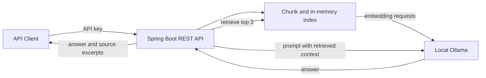

# Enterprise Knowledge Assistant — Spring Boot + Local RAG

**Status:** Source starter prepared; build and runtime not independently verified. No live application or production readiness claimed.

## Objective

A small AI-enabled backend example that answers questions from supplied text documents through a retrieval-augmented generation (RAG) pipeline, running locally with Ollama.

## Architecture

## Features implemented in starter source

- Java 21 / Spring Boot 3.3 REST endpoints
- Basic single-key API authentication (not OAuth or user accounts)
- Chunking, local embeddings, cosine retrieval, and LLM response
- Source excerpts and similarity scores
- Input validation and small pure unit tests
- Dockerfile and Compose with local Ollama

## Design constraints

This is a **learning/demo prototype**, not a production system. Documents are stored in memory and lost on restart. No persistent vector database, real user authentication, rate limiting, full integration tests, deployment validation, or hallucination evaluation. Retrieval text remains untrusted input.

## Source status

A standalone project archive was prepared for review and testing. A dedicated public source repository is not yet created. This page documents the intended engineering design, not a deployed service.
