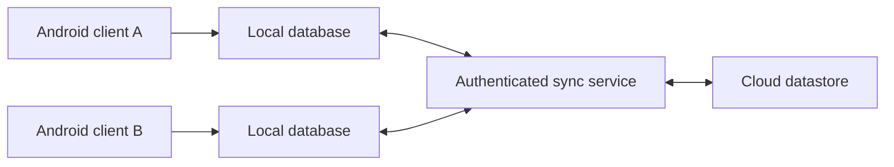

# Ghar Ledger — Personal Project Case Study

**Type:** Android property and household administration application  
**Source:** Private

## Problem
Managing flat-wise rent, tenant records, electricity meter readings, and family administration across two devices requires reliable data entry and synchronization.

## Approach
The application combines local-first Android workflows with a cloud synchronization layer. The project explores durable change propagation, retry handling, conflict safety, tenancy data entry, and practical financial reports.

## Engineering highlights
- Offline-friendly local data entry and bidirectional sync
- Property/flat and tenancy administration
- Electricity meter readings and bill calculations
- Rent reporting and export workflows
- Automated regression checks and cross-device testing

## Architecture (conceptual)

## Privacy and scope
This public document deliberately excludes source code, tenant details, bills, credentials, infrastructure endpoints and household financial information. No live deployment or publicly accessible demo is offered.

## What it demonstrates
Mobile architecture, sync reliability, validation, testing, and end-to-end ownership.
