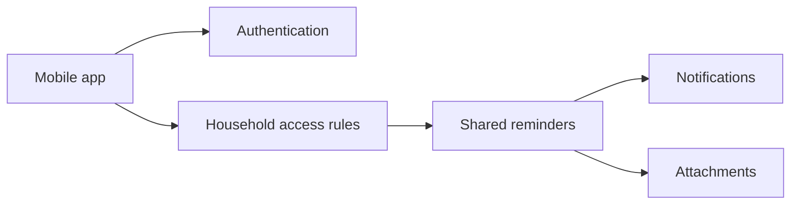

# PehleSe — Personal Project Case Study

**Type:** Shared household reminders application  
**Source:** Private

## Problem
Households need one place to manage upcoming tasks, recurring reminders, and collaboration across people and devices.

## Approach
A mobile-first application with authenticated accounts, multiple household contexts, shared reminders, recurring scheduling, and role-governed access.

## Engineering highlights
- Email and Google sign-in workflows
- Household creation, invitations and membership
- Owner, admin and member role controls
- Cross-device reminder updates and completion tracking
- Attachments, notifications and recurring tasks
- Access-control and multi-account scenario testing

## Architecture (conceptual)

## Privacy and scope
This case study is intentionally high-level. Source code, user accounts, household information and deployment credentials remain private. No public demo or source availability is implied.

## What it demonstrates
Mobile product development, authentication, authorization, shared state and practical user-experience engineering.
